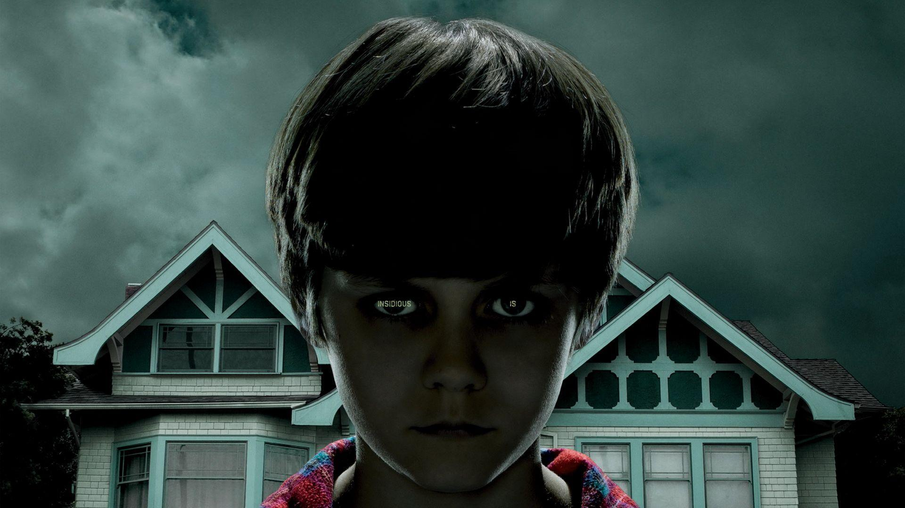

# Netflix Clone

A modern, responsive Netflix-inspired video streaming website built with HTML5, CSS3, and JavaScript. This project showcases a sleek streaming platform UI with interactive features and smooth animations.


## 🎬 Features

### Core Features
- **Responsive Design** - Fully responsive layout that works on desktop, tablet, and mobile devices
- **Interactive Hero Slider** - Dynamic carousel with featured movies and shows with animation effects
- **Movie/Show Categories** - Multiple sections including:
  - Top Picks For You (Favorites)
  - Movies
  - Trending Movies (Top 10)
  - Suggested Sports
  - Trending Shows
- **Smooth Animations** - Fade-in, scale, and transform effects on content
- **User Dropdown Menu** - Profile management, settings, pricing, and logout options
- **Search Functionality** - Quick search bar for finding content
- **Notification System** - Bell icon with notification dropdown
- **Episode Management** - Season selection and episode viewing
- **Video Player Integration** - YouTube trailer links for movies and shows
- **Rating Display** - IMDB ratings and content information
- **Social Sharing** - Share functionality for social media platforms

### Technical Features
- **No Dependencies** - Uses vanilla JavaScript (with jQuery for DOM manipulation)
- **CSS Animations** - Custom animations using CSS3 keyframes
- **Carousel Libraries** - Slick Slider and Owl Carousel for smooth content scrolling
- **Mobile-First** - Optimized for all screen sizes with Bootstrap 4
- **SEO Friendly** - Proper HTML5 semantic structure
- **Font Awesome Icons** - Beautiful icon set for UI elements
- **Bootstrap Grid** - Responsive grid system for layout

## 📁 Project Structure

```
Netflix Clone/
├── index.html          # Main HTML file (4647 lines)
├── avng.html          # Avengers movie page
├── main.js            # JavaScript functionality
├── style.css          # Custom CSS styles (2429 lines)
├── README.md          # Project documentation
│
├── css/               # CSS Libraries & Frameworks
│   ├── bootstrap.min.css
│   ├── all.min.css
│   ├── animate.min.css
│   ├── magnific-popup.css
│   ├── owl.carousel.min.css
│   ├── select2.min.css
│   ├── select2-bootstrap4.min.css
│   ├── slick.css
│   ├── slick-theme.css
│   └── slick-animation.css
│
├── js/                # JavaScript Libraries
│   ├── jquery-3.4.1.min.js
│   ├── bootstrap.min.js
│   ├── popper.min.js
│   ├── slick.min.js
│   ├── slick-animation.min.js
│   ├── owl.carousel.min.js
│   ├── select2.min.js
│   ├── magnific-popup.min.js
│   └── flatpickr.min.js
│
├── images/            # Image Assets
│   ├── episodes/      # Episode thumbnails
│   ├── favorite/      # Favorite movie posters
│   ├── footer/        # Footer images
│   ├── notify/        # Notification images
│   ├── parallax/      # Parallax background images
│   ├── popular/       # Popular movie covers
│   ├── slider/        # Hero slider images
│   ├── suggested/     # Suggested content images
│   ├── top-10/        # Top 10 trending images
│   ├── trending/      # Trending shows images
│   ├── tvthrillers/   # TV thriller images
│   ├── user/          # User profile images
│   ├── logo.png       # Netflix-style logo
│   └── play.png       # Play button icon
│
└── video/             # Video Assets (currently empty)
```

## 🎨 Key Sections

### Header Navigation
- Fixed sticky header with logo and navigation menu
- Dropdown menus for submenu items
- Search bar with smooth expand animation
- Notification center
- User profile menu

### Hero Slider
- 3 featured movies/shows with auto-rotating slides
- Movie details (title, rating, duration, content rating)
- Star ratings display
- Play Now and More Details buttons
- Watch Trailer links

### Content Sections
1. **Top Picks For You** - Personalized movie recommendations
2. **Movies** - Featured movie collection
3. **Trending Movies** - Top 10 most popular content
4. **Suggested Sports** - Sports content recommendations
5. **Avatar Parallax Section** - Feature with parallax effect
6. **Trending Shows** - Latest TV shows with tabs for Overview, Episodes, Trailers, and Similar

### Movie Card Features
- Hover effects with scale and shadow
- Play Now button
- Social sharing options
- Like/Heart counter
- Add to list option
- Age rating badge
- Duration display

## 🚀 Getting Started

### Prerequisites
- A modern web browser (Chrome, Firefox, Safari, Edge)
- No backend server required for basic functionality

### Installation

1. **Clone the repository:**
   ```bash
   git clone https://github.com/yourusername/netflix-clone.git
   cd netflix-clone
   ```

2. **Open in browser:**
   - Double-click `index.html` to open in your default browser
   - Or use a local server:
     ```bash
     # Using Python 3
     python -m http.server 8000
     
     # Using Python 2
     python -m SimpleHTTPServer 8000
     
     # Using Node.js (if you have http-server installed)
     http-server
     ```

3. **Access the site:**
   - Open `http://localhost:8000` in your browser

## 💻 Technologies Used

### Frontend Framework & UI
- **HTML5** - Semantic markup structure
- **CSS3** - Modern styling with animations and transitions
- **Bootstrap 4** - Responsive grid system and components
- **jQuery 3.4.1** - DOM manipulation and event handling

### Carousel & Slider Libraries
- **Slick Slider** - Main content carousel with smooth animations
- **Owl Carousel** - Episode carousel with responsive settings
- **Slick Animation** - Custom animation effects for sliders

### UI Components & Icons
- **Font Awesome 4.7** - Icon library for UI elements
- **Select2** - Enhanced select dropdowns
- **Magnific Popup** - Lightbox for media display
- **FlatPickr** - Date picker functionality
- **Animate.css** - Pre-built CSS animations

## 📱 Responsive Breakpoints

The site is optimized for:
- **Desktop** (1200px and above)
- **Large Screens** (1366px - 1499px)
- **Tablets** (768px - 991px)
- **Mobile** (480px - 767px)
- **Small Mobile** (below 480px)

### Responsive Features
- Collapsible mobile navigation menu
- Adjusted font sizes for smaller screens
- Modified carousel settings for tablet/mobile
- Touch-friendly button sizes
- Optimized image sizing

## 🎯 Usage Examples

### Adding a New Movie/Show
1. Add a new `<li class="slide-item">` to the appropriate section
2. Update the image and content information
3. Style will automatically apply from existing CSS classes

### Customizing Colors
Edit the primary color in `style.css`:
```css
/* Current: Netflix Red */
.text-primary {
    color: #e50914 !important;
}

/* Change to your preferred color */
.text-primary {
    color: #YOUR_COLOR !important;
}
```

### Modifying Header Background
```css
header#main-header {
    background: rgba(20, 20, 20, 0.5) !important;
    /* Adjust the alpha value (0.5) to control transparency */
}
```

## 🔧 Configuration

### JavaScript Features
- **Header Sticky Animation** - Automatically activates on scroll
- **Search Toggle** - Click search icon to expand
- **Carousel Settings** - Configure slide count, speed, and breakpoints in `main.js`
- **Season Selection** - Dropdown for episode season selection

### CSS Customization
- Font Family: 'Playfair Display' (headings), 'Roboto' (body)
- Primary Color: #e50914 (Netflix Red)
- Background: #141414 (Dark Gray)
- Text Color: #d1d0cf (Light Gray)

## 📊 Performance Optimizations

- **Minified CSS/JS** - All libraries are minified versions
- **Lazy Loading** - Images and content loaded progressively
- **CSS Animations** - Hardware-accelerated transforms
- **Responsive Images** - Images scale based on device
- **Efficient Selectors** - Optimized jQuery selectors

## 🌐 Browser Compatibility

| Browser | Support |
|---------|---------|
| Chrome  | ✅ Full |
| Firefox | ✅ Full |
| Safari  | ✅ Full |
| Edge    | ✅ Full |
| IE 11   | ⚠️ Partial |

## 🎬 Featured Content

### Movies
- Avengers
- Frozen
- The Conjuring
- Insidious
- War
- Five Feet Apart
- Chhichore
- Doctor Strange
- Mulan
- Laxmii
- Captain America
- Life of Pi
- Mission Mangal

### Shows
- The Crown
- Harry Potter
- The Queen's Gambit
- Scam 1992
- Stranger Things
- BoJack Horseman
- Peaky Blinders

### Sports
- Basketball
- Volleyball
- Cricket
- Golf

## 🎨 Design Highlights

- **Dark Theme** - Easy on the eyes with Netflix-style dark background
- **Modern Gradients** - Subtle gradient overlays for visual depth
- **Smooth Transitions** - 0.3s to 0.6s transitions for all interactive elements
- **Hover Effects** - Scale, shadow, and color change animations
- **Typography** - Clean, readable fonts with proper hierarchy
- **Icon Integration** - Consistent use of Font Awesome icons throughout

## 📝 Code Examples

### Adding Click Event
```javascript
jQuery('.share-toggle').on('click', function() {
    // Your code here
});
```

### Slick Carousel Configuration
```javascript
jQuery('.favorites-slider').slick({
    dots: false,
    arrow: true,
    infinite: true,
    speed: 300,
    autoplay: false,
    slidesToShow: 4,
    slidesToScroll: 1
});
```

### Responsive Image Handling
```html

```

## 🛠️ Troubleshooting

### Carousel Not Working
- Ensure Slick CSS and JS libraries are loaded
- Check browser console for JavaScript errors
- Verify image paths are correct

### Styling Issues
- Clear browser cache (Ctrl+Shift+Delete)
- Check if style.css is loading properly
- Ensure no conflicting CSS rules

### Mobile Menu Not Opening
- Verify Bootstrap JS is loaded
- Check jQuery version compatibility
- Ensure correct HTML structure

## 📚 Learning Resources

- [Bootstrap 4 Documentation](https://getbootstrap.com/docs/4.0/)
- [jQuery Documentation](https://jquery.com/docs/)
- [Slick Carousel](https://kenwheeler.github.io/slick/)
- [Owl Carousel](https://owlcarousel2.github.io/OwlCarousel2/)
- [Font Awesome Icons](https://fontawesome.com/icons)

## 🔐 Security Considerations

- No sensitive data is stored in the frontend
- All external links should be verified for security
- Consider adding Content Security Policy (CSP) headers
- Sanitize any user input if adding backend functionality

## 📄 License

This project is licensed under the MIT License - see the LICENSE file for details.

```
MIT License

Permission is hereby granted, free of charge, to any person obtaining a copy
of this software and associated documentation files (the "Software"), to deal
in the Software without restriction, including without limitation the rights
to use, copy, modify, merge, publish, distribute, sublicense, and/or sell
copies of the Software, and to permit persons to whom the Software is
furnished to do so, subject to the following conditions:

The above copyright notice and this permission notice shall be included in all
copies or substantial portions of the Software.
```

## 👥 Contributing

Contributions are welcome! Here's how to contribute:

1. **Fork the repository**
   ```bash
   git clone https://github.com/yourusername/netflix-clone.git
   ```

2. **Create a feature branch**
   ```bash
   git checkout -b feature/AmazingFeature
   ```

3. **Make your changes**
   - Update HTML for new content
   - Modify CSS for styling changes
   - Enhance JavaScript for new functionality

4. **Commit your changes**
   ```bash
   git commit -m 'Add some AmazingFeature'
   ```

5. **Push to the branch**
   ```bash
   git push origin feature/AmazingFeature
   ```

6. **Open a Pull Request**

## 🐛 Bug Reports

Found a bug? Please open an issue with:
- Description of the bug
- Steps to reproduce
- Expected behavior
- Actual behavior
- Browser and OS information

## 💡 Future Enhancements

- [ ] Backend integration with Node.js/Express
- [ ] User authentication and account management
- [ ] Database integration for content management
- [ ] Video streaming capability
- [ ] User watchlist/favorites functionality
- [ ] Real-time notifications
- [ ] Advanced search filters
- [ ] Dark/Light theme toggle
- [ ] Multi-language support
- [ ] Progressive Web App (PWA) features

## 📞 Contact & Support

- **GitHub Issues** - For bug reports and feature requests
- **Email** - [your-email@example.com](mailto:your-email@example.com)
- **Twitter** - [@yourusername](https://twitter.com/yourusername)

## 🙏 Acknowledgments

- Inspired by Netflix's modern UI/UX design
- Built with open-source libraries and frameworks
- Thanks to all contributors and users

## 📈 Project Statistics

- **HTML Lines** - 4,647
- **CSS Lines** - 2,429
- **JavaScript Libraries** - 9
- **CSS Libraries** - 10
- **Total Images** - 50+
- **Responsive Breakpoints** - 5

## 🎯 Development Roadmap

### Phase 1 (Complete)
- ✅ Frontend UI/UX design
- ✅ Responsive layout
- ✅ Interactive components
- ✅ Animation effects

### Phase 2 (In Progress)
- 🔄 Backend API integration
- 🔄 User authentication

### Phase 3 (Planned)
- ⏳ Video streaming
- ⏳ Payment gateway integration
- ⏳ Admin panel

## 📖 Additional Notes

This project is a frontend demonstration of a Netflix-like streaming platform. It's designed for educational purposes and showcases:
- Modern responsive web design
- Frontend animation techniques
- jQuery and JavaScript DOM manipulation
- Bootstrap grid system
- CSS3 advanced features

To add backend functionality, consider integrating:
- Node.js/Express.js for server
- MongoDB or PostgreSQL for database
- Authentication with JWT
- Video streaming service (like AWS S3)

---

**Created with ❤️ by [MD SHEHZAD]**

Last Updated: November 26, 2025
